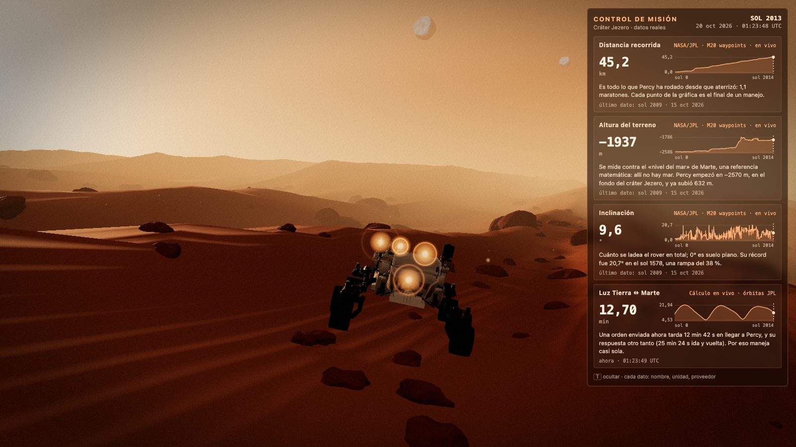
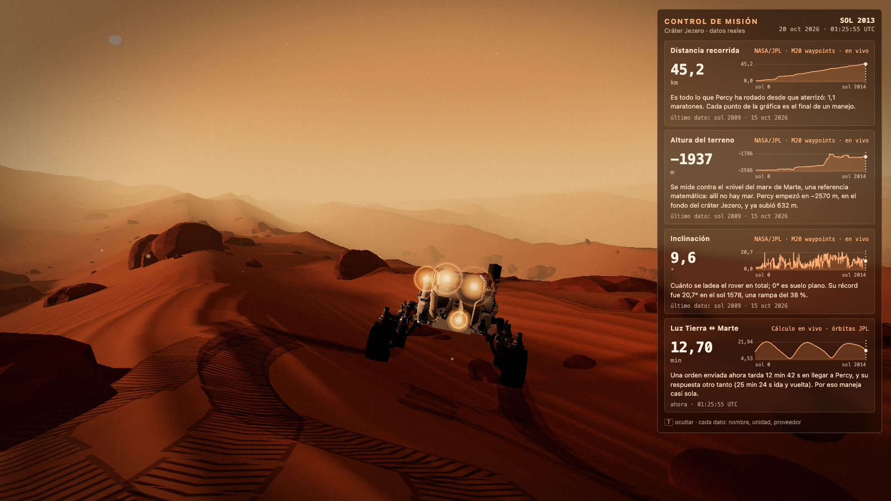
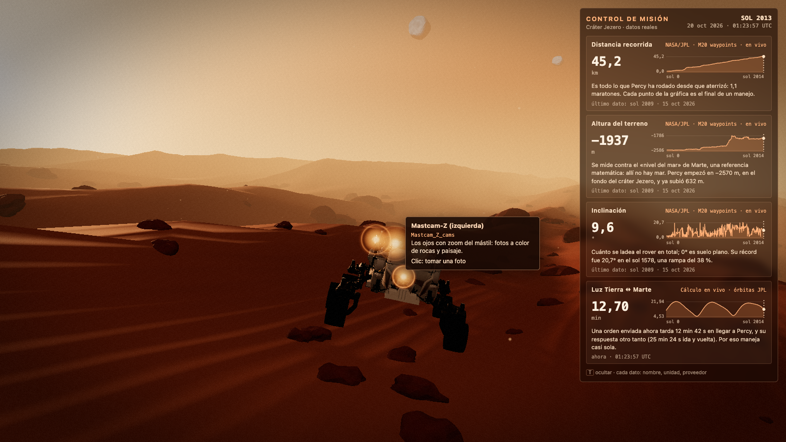
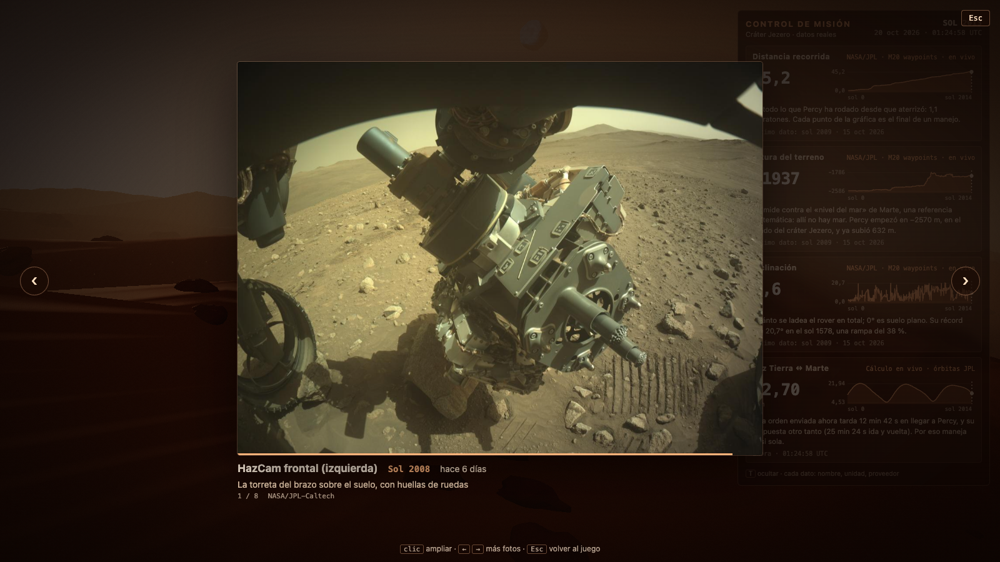

# Perseverancia

Simulación 3D en el navegador del rover **Perseverance** (Percy) de la NASA, explorando un paisaje marciano de película. Hecha con Vite y Three.js.



## Qué hace

- **Paisaje de Marte:** dunas con ondulaciones de arena, rocas, cielo caramelo con polvo, sol de tarde con sombras suaves, Fobos y Deimos, bloom, viñeta y grano de película.
- **Percy de verdad:** el modelo 3D oficial de la NASA a tamaño real (2,7 m de ancho). Se maneja con el teclado, se apoya sobre el terreno con su suspensión y deja huellas con la banda de rodadura.
- **Control de misión** (tecla `T` lo oculta): 4 datos reales, cada uno con nombre, unidad, proveedor, gráfica de toda la misión y una frase simple.
  - Distancia recorrida, altura del terreno e inclinación: historial de manejos de la NASA (`M20_waypoints.json`).
  - Tiempo de luz Tierra ↔ Marte: calculado en vivo con elementos orbitales de JPL (contrastado con JPL Horizons, diferencia máxima 0,1 s).
- **Cámaras de Percy:** puntos que brillan sobre Mastcam-Z, NavCam, HazCam frontal y WATSON. Un clic hace obturador y flash, y revela una foto real que llega de la API de imágenes de la NASA, con su cámara, sol y «hace cuántos días».

| Huellas al conducir | Cámaras con su nombre | Foto real de la HazCam |
|---|---|---|
|  |  |  |

## Controles

| Tecla / acción | Efecto |
|---|---|
| `W` `A` `S` `D` o flechas | Conducir |
| `Shift` | Turbo |
| `T` | Mostrar u ocultar el control de misión |
| Clic en un punto brillante | Tomar una foto |
| Clic en la foto | Ampliar o reducir |
| `←` `→` | Más fotos de esa cámara |
| `Esc` | Volver al juego |
| Arrastrar / rueda | Orbitar / zoom |

Si no tocas la foto, se queda unos segundos y vuelve sola al juego.

## Cómo correrlo

```bash
npm install
npm run dev      # http://localhost:5173
```

Necesita conexión a internet: los datos de misión y las fotos se piden a servidores de la NASA.

## Verificación: `npm run check`

Abre la página en un Chrome sin ventana (Playwright con tu Chrome instalado, sin descargar navegadores) y falla si algo no cumple. Dura unos 2 minutos. Comprueba que:

- no hay errores de consola;
- el rover se maneja con teclas reales y deja huellas;
- los 4 datos de misión cargan con números reales, coinciden con el JSON de la NASA, la luz se actualiza en vivo y `T` oculta el panel;
- cada cámara abre con un clic una foto real de la API (spinner incluido), y funcionan flechas, ampliar, `Esc` y el regreso automático;
- no hay imágenes dentro de `public/`.

Guarda capturas en `check/` (`screenshot*.png`, `photo-*.png`) y lista las piezas del modelo que son cámaras.

## Estructura

```
src/main.js            escena: terreno, rocas, cielo, lunas, luces, postproceso, bucle
src/rover.js           carga del modelo, escala real, conducción, huellas, cámara que sigue
src/mission/           control de misión (patrón de telemetría de Open MCT)
  telemetry.js           objetos de dominio + proveedores (request / subscribe)
  nasaWaypoints.js       proveedor: historial de manejos de la NASA
  lightTime.js, orbit.js proveedor y efeméride del tiempo de luz
  dictionary.js, hud.js  los 4 datos y el panel
src/photos/            cámaras y fotos
  picks.js               IDs de las fotos elegidas a mano (no hay imágenes en el repo)
  catalog.js             pide cada foto a la API de la NASA, con reintentos
  hotspots.js, viewer.js puntos brillantes y visor (obturador, spinner, revelado)
scripts/check.mjs      npm run check
public/models, draco   modelo 3D de Percy y su decodificador
public/data            copia mínima de respaldo de los waypoints
```

## Notas

- **API de fotos lenta:** puede tardar 25 s o más la primera vez y a veces responde 403; el visor muestra un spinner y reintenta.
- **Fotos elegidas a mano**, no automáticas: el servidor de imágenes no permite leer píxeles desde el navegador, así que no se pueden puntuar en vivo. La lista es fija; el «hace N días» sí se calcula en vivo.
- **Velocidad:** el rover real avanza a 4 cm/s; aquí va a 3,5 m/s para poder jugarlo.
- El modelo mide 1,84 m de alto; la NASA indica 2,2 m con el mástil.

## Créditos

Modelo 3D, waypoints y fotos: NASA/JPL-Caltech. Posiciones planetarias: JPL (*Approximate Positions of the Planets*). Patrón de telemetría inspirado en [Open MCT](https://github.com/nasa/openmct).
